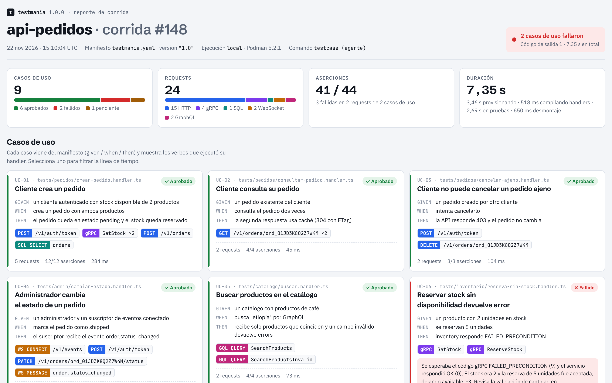
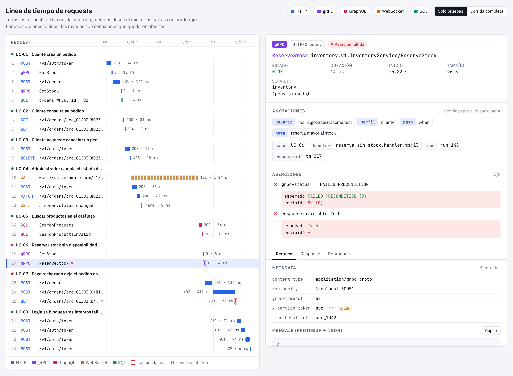

# testcase

Skill para agentes que convierte los casos de prueba que describe una persona en un **reporte HTML** de [testmania](https://testmania.dev). La persona dice qué quiere probar ("un cliente no puede cancelar el pedido de otro"); el agente escribe cada caso como un script TypeScript con Playwright, levanta los servicios con un proxy que guarda la evidencia de cada request y genera el reporte con los scripts de la skill.



El reporte muestra cada caso de uso con sus pasos y los requests que hizo, la línea de tiempo de la corrida y el detalle de cada request: anotaciones, aserciones con el valor esperado y el recibido, headers, body y cómo reproducirlo.



Las capturas salen del reporte de ejemplo, [`testcase/assets/report.example.json`](testcase/assets/report.example.json). Para regenerarlas: `npm run docs:screenshots`.

## Instalación

```sh
bunx skills add JonDotsoy/testcase
```

o desde una copia local:

```sh
bunx skills add ./testcase
```

## Cómo funciona

```text
persona: describe los casos
  └─▶ agente: escribe .testcase/cases/UC-NN.case.ts (defineService + defineCase, Playwright)
  └─▶ cases.ts --plan: servicios al reporte, compose.yaml y local.json
        └─▶ el agente levanta contenedores (podman compose) y procesos locales (local.ts), cada uno con su proxy
              └─▶ cases.ts: corre los casos a través del proxy ──▶ HAR + aserciones
                    └─▶ import-har.ts ──▶ sync-report.ts ──▶ render-report.ts ──▶ .testcase/report.html
```

- **`.testcase/report.json`** es la única fuente de verdad del reporte. Lo mantiene el agente y sigue el schema de [`report-schema.md`](testcase/references/report-schema.md).
- **Los casos se ejecutan en un espacio de trabajo temporal**, fuera del repositorio, con su propio `package.json` y Playwright. No se instala nada en el proyecto que se prueba.
- **Cada servicio HTTP tiene un proxy de evidencia** que guarda cada request y response en un HAR. Puede ser un contenedor (mitmdump con Podman) o un proceso local sin contenedor (`proxy.ts`).

## Un caso de uso

Cada script es autocontenido: declara sus servicios y sus casos. Todo se usa con `await`, y cada paso devuelve lo que devuelve su función.

```ts
import { defineCase, defineService, sensitive, title, given, when, then, notation, check, ensure, between } from "../testcase.ts";

const api = await defineService({ name: "api", endpoint: "https://api.example.com", health: "GET /healthz" });

await defineCase(async () => {
  await title("Cliente no puede cancelar un pedido ajeno");

  const token = await given("Pedro inició sesión", async () => {
    const login = await api.post("/v1/auth/token", { data: { email: "pedro@acme.test", password: sensitive(process.env.PEDRO_PASSWORD) } });
    ensure("status == 200", login.status(), 200); // si falla, el caso se detiene aquí
    return sensitive(login.body.access_token);
  });

  const cancel = await when("Pedro intenta cancelar el pedido de María", async () => {
    notation("usuario", "pedro@acme.test");
    return api.delete("/v1/orders/ord_01JD9", { headers: { authorization: `Bearer ${token}` } });
  });

  await then("la API responde 403", () => {
    check("status == 403", cancel.status(), 403, { expectedFailure: true });
    check("es un error del cliente (4xx)", cancel.status(), between(400, 499), { expectedFailure: true });
    check("trae detail", cancel.body.detail, (d: unknown) => typeof d === "string" && d.length > 0);
  });
});
```

`check` registra la aserción y sigue; `ensure` detiene el caso si falla. El esperado es un valor (igualdad profunda) o un validador: una función, o uno de los listos (`instanceOf`, `between`, `satisfies`).

### Servicios

`defineService` acepta tres tipos:

| Tipo | Se declara con | Qué hace la skill |
|---|---|---|
| Conectado | `endpoint` | El servicio ya existe. Solo le pone un proxy delante. |
| Contenedor | `image` o `build` | Lo levanta con Podman (`compose.yaml` generado), con puertos, variables, dependencias y artefactos (migraciones, seeds). |
| Proceso local | `command`, `cwd?`, `port?` | Corre el comando de shell en esta máquina con `local.ts`, guarda su PID y su log, y le pone un proxy local. |

### Valores sensibles

`report.json` guarda los valores reales en `secrets`, porque sirven para validar y reproducir. El HTML los oculta en todas partes hasta pulsar **Mostrar valores sensibles**. Para compartir el reporte sin ellos, `render-report.ts --strip-secrets` genera una copia limpia. No conviene versionar `report.json` ni `report.html` con valores reales.

## Contenido

| Ruta | Para qué |
|---|---|
| `testcase/SKILL.md` | Flujo de trabajo que sigue el agente. |
| `testcase/references/report-schema.md` | Schema del reporte JSON, con el JSON Schema 2020-12. |
| `testcase/assets/workspace/` | Librería de los casos (`testcase.ts`), el runner (`run.ts`) y un caso de ejemplo. |
| `testcase/assets/` | Plantilla HTML, JSON inicial y el reporte de ejemplo. |
| `testcase/scripts/cases.ts` | Ejecuta los `*.case.ts` en el espacio temporal (`--plan` genera los servicios, `compose.yaml` y `local.json`). |
| `testcase/scripts/local.ts` | Levanta, revisa y detiene los procesos locales y los proxies sin contenedor (`up`, `status`, `down`). |
| `testcase/scripts/proxy.ts` | Proxy de evidencia local que escribe el HAR como mitmdump. |
| `testcase/scripts/import-har.ts` | Importa la evidencia del proxy y la une con las aserciones. |
| `testcase/scripts/sync-report.ts` | Recalcula estados, totales, línea de tiempo e inventario de invocaciones. |
| `testcase/scripts/render-report.ts` | Valida el JSON y genera el HTML. |

Los scripts no tienen dependencias y corren con `bun` o con Node 22.6 o superior.

## Pruebas

Las pruebas validan toda la skill: la librería de los casos, `run.ts --plan` y el `compose.yaml` que genera, `cases.ts`, `import-har.ts`, `sync-report.ts`, `render-report.ts`, el schema del reporte, los procesos locales y el proxy sin contenedor, y un flujo completo con Playwright, un servidor de prueba y el proxy local.

```sh
npm install                          # o bun install
npx playwright install chromium      # para el flujo completo; sin Chromium esas pruebas se omiten
npm test                             # todas
npm run test:unit                    # sin navegador
npm run test:e2e                     # flujo completo
npm run typecheck
npm run docs:screenshots             # regenera las capturas de este README
```

Requieren Node 22.18 o superior. La prueba de `compose.yaml` usa `docker compose config` si está instalado.
